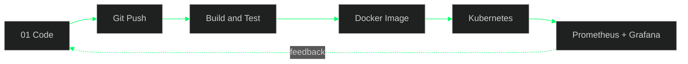

<!-- Paste into README.md of the repo github.com/RavindraM0/RavindraM0 (public repo named exactly RavindraM0) -->

<p align="center">
  
</p>

<p align="center">
  <a href="https://github.com/RavindraM0">
    
  </a>
</p>

<p align="center">
  
  
  
</p>

```text
 0 1 1 0 0 1 0 1 1 0 1 0 0 1 1 0 1 0 1 1 0 0 1 0 1 1 0 1 0 0 1 1
 1 0 0 1 1 0 1 0 0 1 0 1 1 0 0 1 0 1 0 0 1 1 0 1 0 0 1 0 1 1 0 0
```

## `$ whoami`

```bash
ravindra@devops:~$ cat profile.yml
name:    Ravindra M O
role:    Aspiring Cloud & DevOps Engineer
degree:  B.Tech CSE (2026)
status:  open_to_work
focus:   [Linux, AWS, Docker, Kubernetes, CI/CD, Monitoring]
motto:   "Break it, fix it, automate it."
```

## `$ ./pipeline.sh`



## `$ ls ~/projects`

| Project | What it is |
|---|---|
| [End-to-End CI/CD Pipeline with Kubernetes Monitoring](https://github.com/RavindraM0/End-to-End-CI-CD-Pipeline-with-Kubernetes-Monitoring) | CI/CD pipeline deploying to Kubernetes, with monitoring |
| [DevOps](https://github.com/RavindraM0/DevOps) | DevOps practice and experiments |
| [ecommerce](https://github.com/RavindraM0/ecommerce) | E-commerce project |
| [-my-portfolio-](https://github.com/RavindraM0/-my-portfolio-) | Personal portfolio site |
| [Python](https://github.com/RavindraM0/Python) | Python practice and scripts |
| [LeetCode](https://github.com/RavindraM0/LeetCode) | Problem-solving solutions |

## `$ toolbox --list`

<p align="center">
  
</p>

## `$ htop --github`

<p align="center">
  
  
</p>
<p align="center">
  
</p>

## `$ ping ravindra`

<p align="center">
  <a href="https://github.com/RavindraM0"></a>
  <!-- Add yours:
  <a href="https://www.linkedin.com/in/YOUR-ID"></a>
  <a href="mailto:you@example.com"></a>
  -->
</p>

<p align="center">
  
</p>
