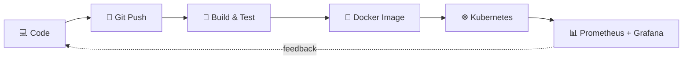

<!-- Header: animated waving banner -->
<p align="center">
  
</p>

<!-- Typing animation -->
<p align="center">
  <a href="https://github.com/ravindram0">
    
  </a>
</p>

<p align="center">
  
  
  
</p>

---

## ⚙️ Operating principles

```yaml
engineer:
  name: Ravindra M O
  role: Aspiring Cloud & DevOps Engineer
  status: open_to_work
  work_mode: remote
  focus:
    - CI/CD automation
    - Containers & Kubernetes
    - Monitoring & observability
    - Infrastructure as Code
  motto: "Build useful things. Learn in public."
```

---

## 🧊 3D contribution graph

<p align="center">
  
</p>

> Generated automatically by the workflow at the bottom of this file.

---

## 🔄 Delivery pipeline



---

## 🚀 Infrastructure shipped

| Project | Description |
|---|---|
| [End-to-End CI/CD Pipeline with Kubernetes Monitoring](https://github.com/RavindraM0/End-to-End-CI-CD-Pipeline-with-Kubernetes-Monitoring) | CI/CD pipeline deploying to Kubernetes with monitoring |
| [DevOps](https://github.com/RavindraM0/DevOps) | DevOps practice and experiments |
| [ecommerce](https://github.com/RavindraM0/ecommerce) | E-commerce project |
| [-my-portfolio-](https://github.com/RavindraM0/-my-portfolio-) | Personal portfolio site |
| [Python](https://github.com/RavindraM0/Python) | Python practice and scripts |
| [LeetCode](https://github.com/RavindraM0/LeetCode) | Problem-solving solutions |

---

## 🛠️ Platform toolkit

```bash
ravindram0@github:~$ toolbox --list
```

<p align="center">
  
</p>

---

## 📈 Service signals

<p align="center">
  
  
</p>

<p align="center">
  
</p>

---

## 🐍 Uptime in motion

<p align="center">
  
</p>

---

## 🤝 Keep it moving

<p align="center">
  <a href="https://github.com/ravindram0"></a>
  <!-- Add your links:
  <a href="https://www.linkedin.com/in/YOUR-ID"></a>
  <a href="mailto:you@example.com"></a>
  -->
</p>

<p align="center">
  
</p>

<!--
=====================================================================
SETUP (delete this block after setup)

Your profile repo must be named exactly: ravindram0/ravindram0
Add this file at .github/workflows/profile-animations.yml

name: Profile animations
on:
  schedule:
    - cron: "0 0 * * *"
  workflow_dispatch:
permissions:
  contents: write
jobs:
  contrib-3d:
    runs-on: ubuntu-latest
    steps:
      - uses: actions/checkout@v4
      - uses: yoshi389111/github-profile-3d-contrib@0.7.1
        env:
          GITHUB_TOKEN: ${{ secrets.GITHUB_TOKEN }}
          USERNAME: ravindram0
      - name: Commit
        run: |
          git config user.name "github-actions"
          git config user.email "actions@github.com"
          git add -A profile-3d-contrib
          git commit -m "Update 3D contrib graph" || echo "no changes"
          git push
  snake:
    runs-on: ubuntu-latest
    steps:
      - uses: Platane/snk/svg-only@v3
        with:
          github_user_name: ravindram0
          outputs: |
            dist/github-snake-dark.svg?palette=github-dark
      - uses: crazy-max/ghaction-github-pages@v3
        with:
          target_branch: output
          build_dir: dist
        env:
          GITHUB_TOKEN: ${{ secrets.GITHUB_TOKEN }}
=====================================================================
-->
